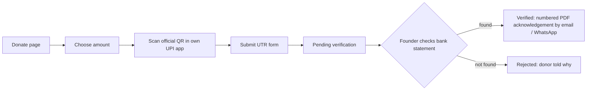
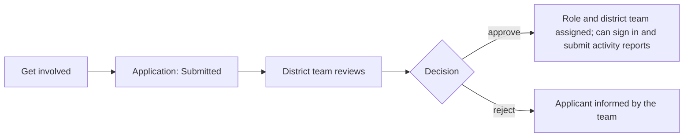
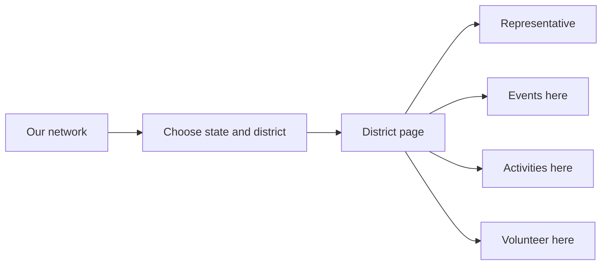
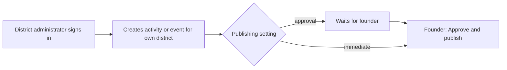
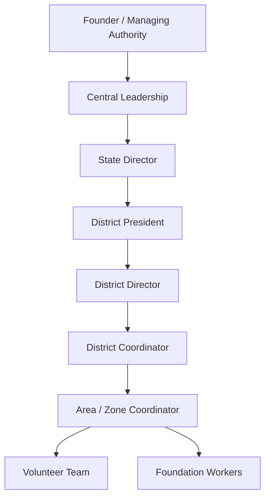
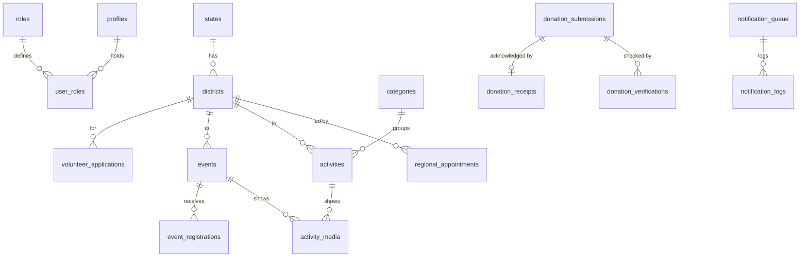
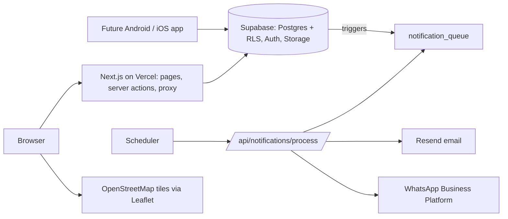

# Vrutsa Foundation — research, architecture and plan

## 1. Reference research

How this was done: the three sites could not be opened directly from the build environment, so this comparison
rests on their publicly indexed pages (links at the end) rather than a full visual walkthrough. Treat the design
observations as directional and check them against the live sites.

| | Gates Foundation | StartupTN | BNI India |
|---|---|---|---|
| What the site is for | Explaining a mission, the work and where the money goes | One portal for a state-wide ecosystem | Helping a visitor find and visit their local chapter |
| Best design idea | Photography of real people with a factual caption (who, where, when); generous white space; one clear statement per section | Programme cards that say who each scheme is for | Plain numbered "how it works" steps |
| Best functionality | Work organised into divisions, then programme strategies; a public, searchable record of grants; annual reports | Registration through the portal; regional hubs that run their own events; separate entry points per stakeholder | "Find a chapter": pick a region, see the chapter, contact its president before visiting |
| Navigation | Few top-level items | Wider, programme-heavy | Short, with Find a Chapter as the main action |
| Organisation model | Central, by programme | Central office plus regional hubs across the state | National leadership → regional directors → chapters, each with a named president and leadership team |
| Trust signals | Published financials and a "how we work" section | Government identity, published schemes | Named leaders at every level |

**Adopted for Vrutsa**

1. From Gates: the order of the story (who we are → what we do → proof → how to take part), photography with factual captions, a public record of work (the Activities page), and a plain statement of how money is handled ("How your donation is verified").
2. From StartupTN: one platform where a person finds programmes, events and their regional team, with optional registration.
3. From BNI: the district is the unit. Every district has a page, a named representative, its own events and activities, and "choose your district" is the main action on the network page.

**Deliberately left out of version 1**

- Searchable financial or grant database and annual-report library (add when audited figures exist).
- Stakeholder-specific portals, mentor matching, smart cards (StartupTN): a partner portal is a future item.
- Member-only chapter tools, attendance and referral tracking (BNI): volunteer attendance and tasks are future items.
- Headline counters and testimonials: nothing is shown that is not counted live from the database.
- Multilingual pages.

## 2. Sitemap

```
/                      Home
/about                 About us (mission, vision, objectives, approach, founder message, leadership)
/activities            Activities, filter by category / district / year / date
/activities/[slug]     One activity with photographs and videos
/events                Upcoming and past events
/events/[slug]         One event: details, map, registration, results
/network               State and district picker, map, leadership, all districts
/network/[district]    District page: representatives, map, events, activities, volunteer link
/donate                Amount → official QR → confirmation form; how verification works
/get-involved          Volunteer / worker application
/login /register       Optional member account
/account               Profile, application status, registrations, donation acknowledgements
/privacy /terms        Legal pages (text entered in admin)
/admin                 Private admin panel (section 6)
```
Main menu: About us, Our activities, Events, Our network, Get involved. Login and Donate sit apart on the right.

## 3. Homepage wireframe

```
┌────────────────────────────────────────────────────────────────────┐
│ LOGO    About  Activities  Events  Network  Get involved   Login [Donate] │
├────────────────────────────────────────────────────────────────────┤
│  PHOTOGRAPH SLIDER (3–5 real activity photographs)                  │
│  ┌─────────────────────────────┐                                    │
│  │ Mission statement (H1)      │  white panel, black text            │
│  │ Short description           │                                    │
│  │ [Explore] [Donate] [Get involved]                                │
│  │ slide caption        ● ○ ○  ‹ ›                                   │
│  └─────────────────────────────┘                                    │
├────────────────────────────────────────────────────────────────────┤
│ Who we are  [Read more]   │ Mission / Vision / Purpose / Commitment  │
├────────────────────────────────────────────────────────────────────┤
│ Our focus areas    [saffron] [green] [kumkum] [peacock] cards        │
├────────────────────────────────────────────────────────────────────┤
│ Our work on the ground       3 activity cards        See all         │
├────────────────────────────────────────────────────────────────────┤
│ Upcoming events    [date] title, venue               [View details]  │
├────────────────────────────────────────────────────────────────────┤
│ A network, district by district [View our network] │ leader profiles │
├──────────────────────── green band ────────────────────────────────┤
│ Give directly to the foundation   [Donate now]              [QR]     │
├──────────────────────── saffron band ──────────────────────────────┤
│ Give your time                                  [Apply to volunteer] │
├────────────────────────────────────────────────────────────────────┤
│ Footer: logo, address │ Explore │ Contact │ Giving, legal            │
└────────────────────────────────────────────────────────────────────┘
```
A section with no content yet is hidden or shows a plain "will be published here" note. With no slides, the hero
shows the mission statement beside the network motif from the logo.

Design system: white page, black text. Saffron `#F0A500` and leaf green `#0F5A1F` come from the logo; kumkum
`#9F1239` and peacock `#0B5C74` are supporting colours for focus-area cards and status. Headings in Bricolage
Grotesque, text in Instrument Sans (both bundled, no external font requests).

## 4. User journeys






## 5. Hierarchy


The levels are rows in the `roles` table (name, rank, scope, can_manage, can_contribute). Adding a level is adding a row.

## 6. Roles and permissions

Enforced in the database (Row Level Security), not only in the interface.

| Capability | Founder | Central leadership | State Director | District President / Director / Coordinator | Zone coordinator, volunteer, worker | Member | Public |
|---|---|---|---|---|---|---|---|
| Browse site, donate, apply, register for events | ✓ | ✓ | ✓ | ✓ | ✓ | ✓ | ✓ |
| Own profile, application status, own acknowledgements | ✓ | ✓ | ✓ | ✓ | ✓ | ✓ | – |
| Submit activity reports and photographs for approval | ✓ | ✓ | own state | own district | own district | – | – |
| Create and edit activities and events | all | all | own state | own district | own drafts only | – | – |
| Publish without approval | ✓ | per setting | per setting | per setting | never | – | – |
| Review volunteer applications | all | all | own state | own district | – | – | – |
| Grant management roles, appoint or remove leaders | ✓ | – | – | – | – | – | – |
| Districts, states, focus areas, website content, settings | ✓ | – | – | – | – | – | – |
| See and verify donations, issue receipts | ✓ | – | – | – | – | – | – |
| Notification log, audit log, user list | ✓ | – | – | – | – | – | – |

## 7. Database

Files: `supabase/migrations/0001_schema.sql` (tables), `0002_security.sql` (permission functions, business rules, RLS),
`0003_notifications.sql` (queue), `0004_storage.sql` (buckets).


Also: `hero_slides`, `foundation_settings`, `notification_preferences`, `audit_logs`.
Key rules: one UTR can be submitted once; one registration per email per event; one message per person per event per
channel; a donation changes status only through `verify_donation()` / `reject_donation()`.

## 8. Technology architecture


Business rules live in the database (permissions, publishing workflow, donation verification, notification queue),
so a mobile app that talks to Supabase gets the same behaviour without a second backend.

## 9. Three-day plan

| Day | Work | State in this delivery |
|---|---|---|
| 1 | Research, design system, public pages, schema, auth | Built |
| 2 | Admin modules, permissions, volunteers, activities, events, uploads, donation workflow, receipts, maps | Built; needs your Supabase project to run live |
| 3 | Connect Supabase, email, WhatsApp; enter real content; test every role; deploy | Yours, with `docs/OPERATIONS.md` |

Must-have items are all in the build. Should-have items included: event registration, WhatsApp sending code
(inactive until configured). Not included: advanced analytics, volunteer performance reports, advanced search,
detailed donation reporting, and everything listed under Future version.

## 10. Accounts and material needed

| Needed | For | Who |
|---|---|---|
| Supabase project (URL, anon key, service role key) | Everything | You |
| Vercel (or other Node hosting) and the domain | Hosting | You |
| Resend account with the sending domain verified (DNS records) | Email | You |
| Meta Business account, WhatsApp Business Platform number, approved templates | WhatsApp | You; approval takes days, start early |
| Official UPI QR image, UPI ID, account name, bank details | Donate page | Foundation |
| Mission, vision, about text, focus areas, photographs, founder message | Content | Foundation |
| Address, phone, email, social links | Footer | Foundation |
| Privacy policy and terms; registration details; any 80G / FCRA status | Legal pages and receipts | Foundation with its legal and tax advisers |

## Sources

- Gates Foundation: [Our work](https://gatesfoundation.org/our-work), [About](https://www.gatesfoundation.org/about), [Committed grants](https://www.gatesfoundation.org/about/committed-grants?page=1), [Commitment to transparency](https://www.gatesfoundation.org/about/policies-and-resources/information-sharing-approach)
- StartupTN: [Programme overview](https://www.startupgrantsindia.com/providers/startuptn), [Regional hubs (Inc42)](https://inc42.com/?p=464917), [TANSEED press release](https://kygcms.tn.gov.in/cms_migrated/document/press_release/pr240124_e_160.pdf)
- BNI India: [Find a chapter](https://bni-india.in/en-IN/findachapter), [Regional websites](https://bni-india.in/en-IN/regionlist), [About and leadership](https://bni-india.in/en-IN/about), [FAQ](https://bni-india.in/en-IN/faq)
